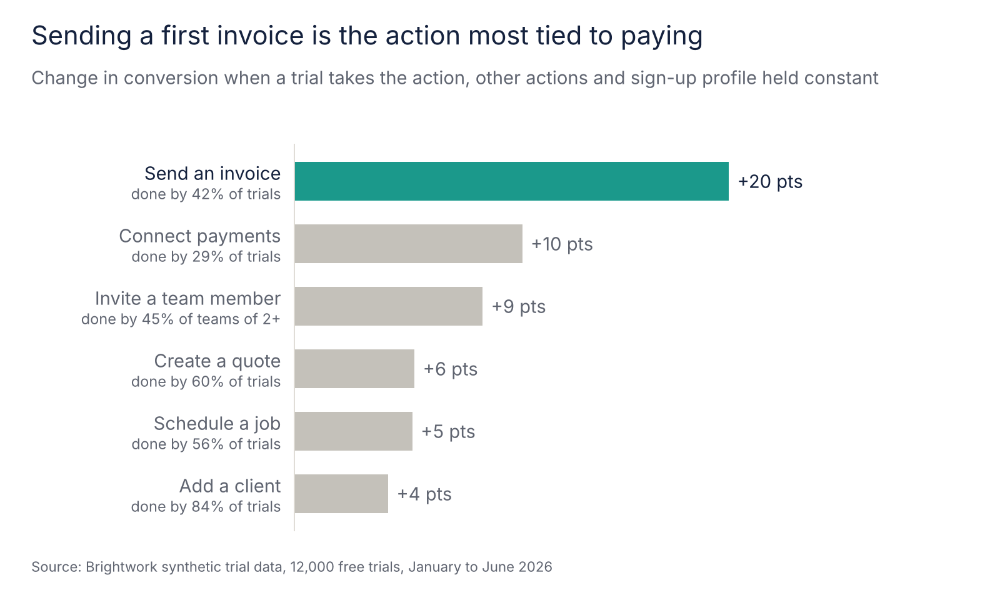
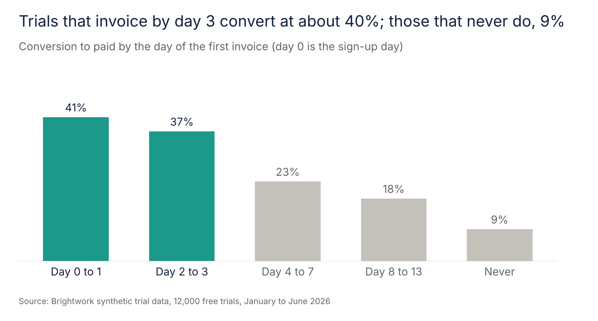
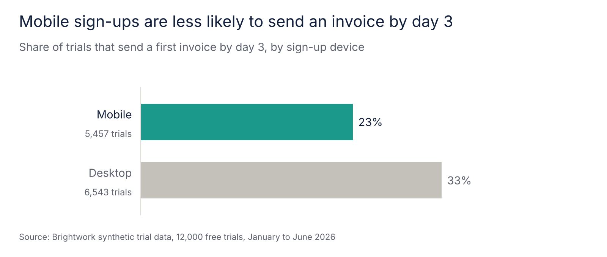

# Trial Activation Milestone: Which Trial Action Predicts Paying, and How Fast Must It Happen?

An analysis of 12,000 free trials at Brightwork, a fictional scheduling and invoicing app for small trades businesses (landscapers, cleaners, plumbers, painters). It ranks six setup actions by how strongly they are tied to converting, checks how timing changes the picture, finds who falls behind, and sizes the onboarding test that would prove the result.

Built in **DuckDB SQL**, with Python for the data generation, regression, bootstrap, test sizing and charts.

## The question

Every new Brightwork account gets a 14-day free trial, and 19.6% convert to paid. Onboarding currently treats every setup step the same. **Which single action should onboarding push every trial toward, and by when?**

## The result

**Make "send a first invoice to a real client by day 3" the trial activation milestone, and build onboarding around it.** Then prove it with a two-stage randomized test before rolling it out.

- **Sending an invoice is the action most tied to paying.** With the other actions and the sign-up profile held constant, it adds 19.8 points to the chance of converting (95% bootstrap interval 18.3 to 21.2). Connecting payments comes next at 10.4. Adding a client, which 84% of trials do, adds only 4.3
- **Timing matters.** Trials that invoice by day 3 convert at about 40%, against 9% for trials that never invoice. After adjustment, invoicing by day 3 adds 26.0 points; invoicing later adds 11.3
- **Only 28.5% of trials get there by day 3,** and mobile sign-ups trail desktop (23% against 33%). Mobile is where onboarding has the most room to help
- **Raw comparisons overstate every action.** Motivated trial users do more of everything. Even after adjustment, adding a client shows 4.3 points when it has no real effect in this data, so every adjusted figure is an upper bound. That is why the recommendation ends in a test

## Charts







## The test

Full plan: [docs/onboarding_test_plan.md](docs/onboarding_test_plan.md).

| Stage | Primary metric | Lift to detect | Trials per arm | Length |
|---|---|---|---|---|
| 1 | Invoice sent by day 3 | 5 points | 1,342 | 6 weeks |
| 2 | Conversion to paid | 2.5 points | 4,148 | 18 weeks |

Stage 1 answers quickly whether onboarding can move the milestone at all. Stage 2 answers whether moving it moves revenue.

## What it's worth

If onboarding moves 5 to 10 more trials in every 100 to an invoice by day 3, Brightwork gains **156 to 624 extra paying accounts a year**, worth **$148K to $592K in annual revenue**. The low end halves the day-3 effect to allow for leftover bias. Assumptions, all stated in `scripts/run_analysis.py`: 24,000 trials a year and $79 a month per account.

## Method

1. **Data:** 12,000 trials with sign-up profile, dated setup actions and conversion. The data is synthetic, generated with planted effects (see `scripts/generate_data.py`)
2. **Actions and timing:** SQL builds one row per trial with the first day of each action (`sql/02_trial_view.sql`), raw conversion gaps (`sql/03_milestone_rates.sql`), conversion by invoice day (`sql/04_invoice_timing.sql`) and who reaches the invoice by day 3 (`sql/05_reach_by_segment.sql`)
3. **Adjusted effects:** a logistic regression with all six actions plus trade, team size, source and device; each action's effect is the average change in predicted conversion when it is switched on, with a 300-sample bootstrap interval. Team invites are measured only for teams of two or more
4. **Test sizing:** two-proportion sample sizes at 80% power and 5% significance, converted to weeks at the current trial volume
5. **Check:** a hidden file of each trial's motivation (used only by the tests) confirms that adjustment moves the estimates toward the truth

## How to run

```
pip install -r requirements.txt
python scripts/generate_data.py
python scripts/run_analysis.py
python scripts/make_charts.py
pytest tests
```

## What is in the repo

| Path | Contents |
|---|---|
| `scripts/generate_data.py` | Synthetic trials, setup events and outcomes (fixed seed) |
| `sql/` | Load, one row per trial, raw action gaps, invoice timing, reach by segment |
| `scripts/run_analysis.py` | Adjusted effects, bootstrap intervals, test sizing and value |
| `scripts/make_charts.py` | The three charts |
| `results/` | Every table the README quotes |
| `docs/onboarding_test_plan.md` | Hypothesis, design, sample sizes, guardrails and decision rules |
| `tests/` | Reproducibility and result checks |

All companies, trials and figures are fictional. The data is synthetic.
